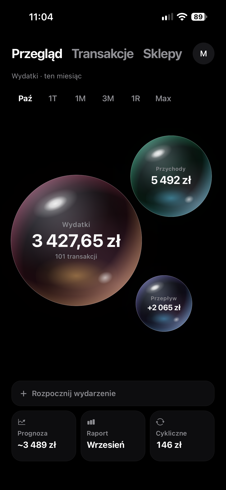
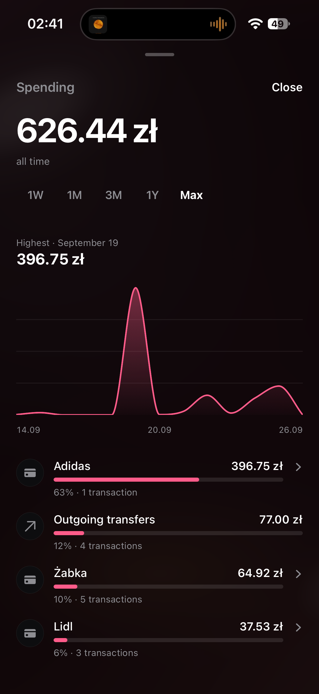
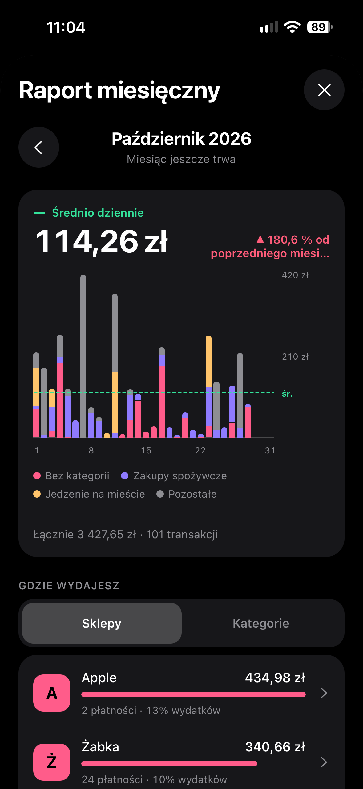
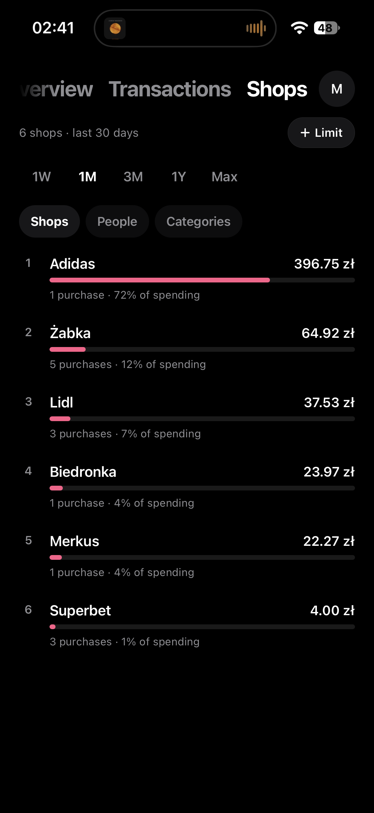

# BankStats

**BankStats** is a privacy-first spending tracker for iPhone. It turns the push notifications your bank and Apple Wallet already send into a clean, categorized history of where your money goes, without asking for a bank login or connecting to your bank account.

Notifications are read and interpreted on the phone. Transactions live in an encrypted local database, and cloud sync across your devices is optional. On top of that history, BankStats shows spending by shop, person and category, tracks limits with notifications in the tone you choose, and puts the numbers on your Home Screen and Lock Screen.

Website: [bankstats.app](https://bankstats.app) · Product specification: [docs/PRODUCT-SPEC.md](docs/PRODUCT-SPEC.md)

## Technology stack

<div align="center">

| Area | Technology |
|:---:|:---:|
| Mobile application |  |
| Native modules |  |
| Widgets |  |
| Local storage |  |
| Backend and sync |  |
| Authentication |  |
| Subscriptions |  |
| Exchange rates |  |
| Website |  |
| Tooling |  |

</div>

## Table of contents

- [Features](#features)
- [Preview](#preview)
- [How a transaction is captured](#how-a-transaction-is-captured)
- [Workspace](#workspace)
- [Delivery lanes](#delivery-lanes)
- [Development](#development)
- [Verification](#verification)

## Features

- **No bank connection**: transactions come from notifications of supported banks (Millennium, PKO BP, ING, mBank, Erste) and Apple Wallet, captured by a Shortcuts automation. Revolut is coming soon.
- **On-device parsing**: shared, versioned bank rules are interpreted natively in Swift and Kotlin. Raw notification text never leaves the phone.
- **Wallet and bank pairing**: an Apple Pay purchase produces a Wallet push and a bank push. BankStats silently merges them into one transaction named after the Wallet shop, and drops a bank push captured twice.
- **Encrypted local storage**: SQLCipher database on the device, keys in the Keychain.
- **Optional cloud sync**: Convex keeps your devices in sync, can be turned off per device, and the cloud copy can be deleted on its own.
- **Overview**: income, spending and net flow for this month, a week, a month, three months, a year or all time, compared with the previous period.
- **Shops, people and categories**: rankings with a detail view per shop, its own period filter, a spending chart and history.
- **Limits and alerts**: spending limits for everything, a category or a shop, with passive, mildly aggressive or very aggressive notification tones.
- **Insights**: monthly report, forecast, recurring payments and events that group spending from a trip or a renovation.
- **Widgets**: Home Screen and Lock Screen widgets.
- **Foreign currencies**: payments abroad are converted to PLN with the National Bank of Poland exchange rates.
- **Statement import**: PDF statements are read on the device to fill gaps in the history.
- **Your data**: CSV and JSON export, device revocation and full account deletion, including the RevenueCat customer.
- **BankStats Premium**: monthly or yearly subscription through the App Store, with a free trial and offer codes.

## Preview

<div align="center">

| Overview | Spending | Monthly report | Shops |
|:---:|:---:|:---:|:---:|
|  |  |  |  |

</div>

## How a transaction is captured

```
Bank or Wallet push
        │
        ▼
Shortcuts automation ──► "Capture Bank Notification" App Intent
        │
        ▼
Encrypted inbox (SQLCipher) ──► shared bank rules ──► normalized transaction
        │                                                    │
        │                         Wallet ↔ bank pairing, repeat check
        ▼                                                    ▼
Unrecognized notifications wait                     encrypted outbox on the phone
for review on the device                                     │
                                                             ▼
                                              optional sync to Convex
```

## Workspace

A bun workspace with one boundary per concern:

| Package                       | Contents                                                                      |
| ----------------------------- | ----------------------------------------------------------------------------- |
| `mobile`                      | Expo application, organized by product feature ([ADR 0014](docs/adr/0014-organize-frontend-code-by-feature.md)) |
| `packages/app-config`         | Delivery lane resolution and runtime support checks                            |
| `packages/parser-rules`       | Shared versioned bank rules ([ADR 0005](docs/adr/0005-share-parser-rules-across-native-interpreters.md)) |
| `packages/ingestion-native`   | Swift and Kotlin ingestion modules ([ADR 0004](docs/adr/0004-use-expo-with-native-platform-modules.md)) |
| `services/convex`             | Convex functions, schema, and auth configuration                               |
| `website`                     | Static landing page, privacy policy, support and account deletion pages        |

## Delivery lanes

Every build belongs to exactly one lane, declared by `EXPO_PUBLIC_APP_ENV`:

| Lane          | Bundle identifier            | Scheme               | Clerk credentials |
| ------------- | ---------------------------- | -------------------- | ----------------- |
| `development` | `com.bankstats.app.dev`      | `bankstats-dev`      | `pk_test_…`       |
| `preview`     | `com.bankstats.app.preview`  | `bankstats-preview`  | `pk_test_…`       |
| `production`  | `com.bankstats.app.preview`  | `bankstats`          | `pk_live_…`       |

Development installs side by side with the other lanes. Preview and production share `com.bankstats.app.preview`, so TestFlight and the App Store ship the same app and the Shortcuts automations bound to it keep working. Lanes never share deep links. Nothing defaults to a lane: the Expo config
fails if `EXPO_PUBLIC_APP_ENV` is unset, and the application refuses to start when a lane is paired
with credentials belonging to another one — a preview build cannot silently run on production Clerk
keys, and a production build cannot ship pointing at a test instance.

## Development

Expo Go is not a supported runtime ([ADR 0004](docs/adr/0004-use-expo-with-native-platform-modules.md)); the app rejects it at startup. Use a development build.

After completing the mobile setup (see [mobile/README.md](mobile/README.md)), build, install, and run the app together with Convex:

```bash
./run.sh ios
./run.sh android
./run.sh web      # browser, no native modules
./run.sh start    # bundler only, once a dev build is already installed
```

## Verification

```bash
bun run typecheck
bun test
bun run lint
```

The same checks run in GitHub Actions on every pull request, together with `expo-doctor`, the Swift parser-rule conformance and the native pairing and encrypted inbox conformance suites.

By NikkO and Maciuś
